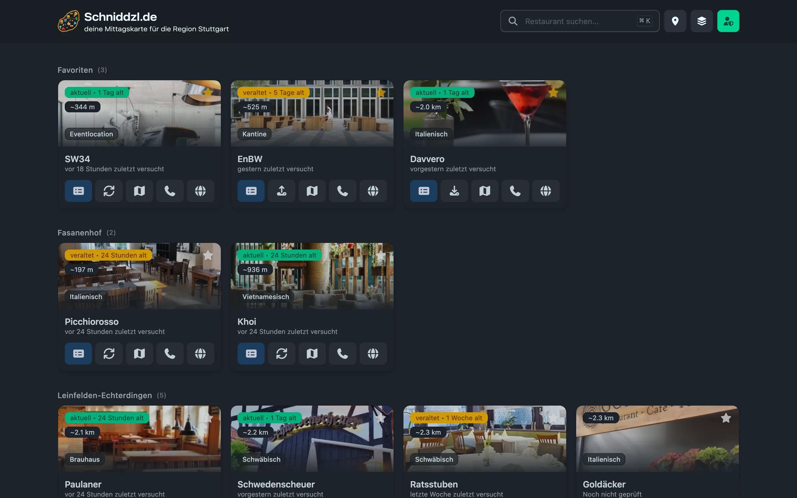
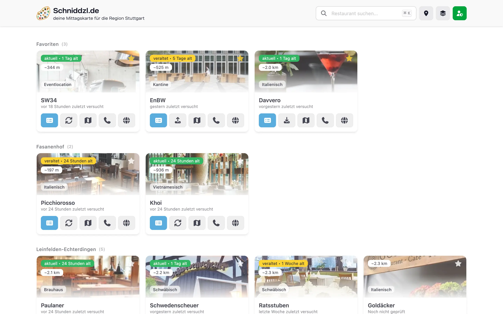

<div align="center">

# Mittagskarte

[](https://github.com/flohoss/mittagskarte/actions/workflows/ci.yaml)
[](https://github.com/flohoss/mittagskarte/actions/workflows/ci.yaml)

Mittagskarte fetches, uploads, converts, and serves lunch menus for restaurants.

</div>

The current stack is:

- Go backend with PocketBase
- Vue 3 frontend built with Vite
- PocketBase collections and migrations for restaurant data
- Playwright for scraping
- [SnapOtter](https://github.com/snapotter-hq/snapotter) for image and PDF processing via API
- Optional [Telegram bot](https://github.com/go-telegram/bot) for uploading menus from a chat

## Screenshots

<p align="center">
  
  
</p>

## Architecture

The app is split into two parts during development:

- `backend/`: PocketBase app, custom API routes, migrations, scraping pipeline, Telegram importer
- `frontend/`: Vue application

In production, the Vue app is built to `dist` and served directly by the Go/PocketBase server.

Frontend routes:

- `/`: restaurant overview with search, sorting, grouping, and favorites
- `/restaurants/<slug>`: menu history for a single restaurant
- `/datenschutz`: privacy page

Server routes:

- `/`: Vue app entrypoint (`index.html`)
- `/assets/*`: built frontend assets from Vite
- `/static/*`: static frontend assets
- `/_`: PocketBase dashboard and internal UI
- `/api/*`: PocketBase API plus custom backend endpoints
- `/api/telegram/<secret>`: Telegram webhook (production only)
- `/health`: simple health endpoint returning `.`
- `/sitemap.xml` and `/robots.txt`: sitemap and crawler rules

## PocketBase Data Model

The application schema is managed through PocketBase migrations in `backend/migrations`.

Current app collections:

- `restaurants`
- `selectors`
- `menus`
- `telegram_chats`

The app collections are publicly listable and viewable. `telegram_chats` has no public API rules and is managed by superusers in the dashboard.

Collection relationships:

- each restaurant can reference multiple `selectors` via `navigate`
- each menu belongs to exactly one restaurant (`menus.restaurant`)
- each restaurant stores a rolling list of latest menu ids in `restaurants.menus`
- each `telegram_chats` record binds one private Telegram chat (`chat_id`, unique) to up to 10 restaurants

Restaurants have a required, unique `slug` that is used in detail page URLs, and an optional `holiday_until` date (`YYYY-MM-DD`). Existing restaurants were backfilled with a slug generated from their name; new ones set it in the dashboard. While a restaurant is on holiday, or on one of its `rest_days`, scheduled scrapes are skipped; expired holidays are cleared automatically.

Menu retention is controlled by the PocketBase relation field `restaurants.menus.maxSelect`.
You can change this value in the PocketBase GUI and the backend will enforce it during cleanup.

The backend also uses PocketBase auth for protected operations.

Protected custom endpoints:

- `POST /api/restaurants/scrape`

`menus.CreateRule` requires authentication, so uploads go through the logged-in frontend. `users.CreateRule` is superuser-only — there is no self signup, superusers create accounts.

## How It Works

Restaurant menus can be obtained in four ways:

- scrape content from websites
- download files directly
- upload files manually through the frontend
- upload files through the Telegram bot (see below)

Files are processed by [SnapOtter](https://github.com/snapotter-hq/snapotter), a self-hosted file processing service running as a Docker container in the same stack. The backend sends scraped or uploaded files to the SnapOtter API, which handles image trimming, PDF-to-image conversion, stitching, and WebP optimization. The processed WebP images are then stored in PocketBase-managed records.

For images, the backend uses SnapOtter's pipeline API to chain `smart-crop` (trim) and `optimize-for-web` (WebP) in a single request. The WebP width cap depends on the menu's orientation: portrait menus are capped at 1200px, landscape menus at 1920px.

In addition to the full-size WebP, the backend generates a small preview WebP for every menu (`preview` field), also orientation-aware: portrait previews are capped at 1200px and landscape previews at 600px, both at a lower quality. On startup, the backend backfills missing previews for all existing menus. The restaurant detail page renders the previews and only loads the full-size image when a menu is opened.

For PDFs, the backend first inspects the file locally with `pdfinfo` and `pdfimages` (from `poppler-utils`) to read page count, page dimensions, document metadata, and embedded image resolution. The DPI is computed dynamically: it targets a 4000px output width from the page size, but if the page is small with a high-resolution embedded image (e.g. Canva exports with tiny page sizes), the image's pixel width is used instead to ensure full fidelity (clamped to 150–1200 DPI). The full metadata is stored on the menu record and compared to the latest menu — if identical, conversion is skipped entirely. Otherwise the backend calls `pdf-to-image` to render all pages as PNG, stitches multiple pages vertically with `stitch`, then optimizes the result to WebP.

For each menu create event, the backend:

- inspects PDF metadata via `pdfinfo`/`pdfimages` and skips conversion if metadata matches the latest menu
- sends the input file to SnapOtter and downloads the processed `webp`
- generates an orientation-aware preview WebP alongside the full-size image
- stores calculated dimensions (`width`, `height`, `landscape`) and `pdf_metadata`
- computes a content hash and rejects unchanged uploads/scrapes
- prepends the new menu id to the restaurant `menus` relation
- removes older menu records beyond `restaurants.menus.maxSelect`

Scheduled scrapes also honour holidays and rest days: restaurants whose `holiday_until` has not passed yet, or that are closed on today's weekday, are skipped, and expired holidays are cleared before the queue is filled.

## Telegram Bot

The backend can optionally run a Telegram bot so restaurant operators can push a menu straight from their phone. The bot is enabled as soon as `TELEGRAM_BOT_TOKEN` is set; without it the feature is off and a stray `TELEGRAM_SECRET` is rejected at startup.

Flow:

1. An operator opens the bot in a private chat. `/start` greets with the chat id, `/id` returns just the id.
2. A superuser binds that chat id to one or more restaurants in the `telegram_chats` collection (only restaurants with `method = upload` accept Telegram uploads).
3. The operator sends a photo, image document, or PDF.
4. With a single bound restaurant the upload starts immediately. With several, the bot sends an inline keyboard to pick one; the pending file is kept for 10 minutes.
5. The file is downloaded (20 MB limit) and handed to the shared scrape queue, so Telegram uploads share deduplication, cooldown, and status broadcasts with scrapes and downloads. The reply reports success, "unchanged", or failure.

Transport depends on `DEV`:

- development: long polling. The bot deletes any existing webhook before polling starts (Telegram rejects `getUpdates` while a webhook is registered).
- production: webhook on `/api/telegram/<TELEGRAM_SECRET>`. There is no extra variable to set — the backend derives the webhook URL from `APP_URL` and `TELEGRAM_SECRET` and registers it itself, so `APP_URL` must be the public `https` URL of the deployment.

Group and channel chats are refused; only private chats can be bound.

## Selectors and Examples

In the PocketBase model, each restaurant can reference multiple selector records through the relation field `navigate`.

Each selector record contains:

- `locator`: CSS selector or XPath
- `attribute`: optional attribute to read (for example `src` or `href`)
- `style`: optional CSS injected before interaction, useful to hide overlays or cookie banners

Typical usage pattern:

- First selector steps are used for navigation (clicks)
- Last selector step is used for extraction or screenshot logic

Example selector list:

```yaml
navigate:
	- locator: ".cookie-accept-btn"
		attribute: ""
		style: ""
	- locator: "a.mittag-link"
		attribute: "href"
		style: ""
```

### Example 1: Direct Download (method = download)

Use `method = download` and set the first selector locator to the direct file URL.

```yaml
restaurant:
	method: "download"
	content_type: "pdf"
	navigate:
		- locator: "https://example.com/mittagskarte.pdf"
			attribute: ""
			style: ""
```

### Example 2: Image Download via Attribute (method = scrape)

Set `attribute` on the last selector to read an image or link source.

```yaml
restaurant:
	method: "scrape"
	content_type: "image"
	navigate:
		- locator: ".menu-image img"
			attribute: "src"
			style: ""
```

### Example 3: PDF Link via XPath (method = scrape)

XPath works as locator input as well.

```yaml
restaurant:
	method: "scrape"
	content_type: "pdf"
	navigate:
		- locator: "//a[contains(text(), 'Mittagstisch')]"
			attribute: "href"
			style: ""
```

### Example 4: HTML Screenshot with Injected Style (method = scrape)

For HTML content, the scraper can screenshot the selected element. Optional style can hide fixed headers or navigation.

```yaml
restaurant:
	method: "scrape"
	content_type: "html"
	navigate:
		- locator: "p.paragraph-mittagstisch-right-corona"
			attribute: ""
			style: ".w-nav { display: none !important; }"
```

### Dynamic Date Placeholders in Locators

You can use date placeholders in selector locators:

```yaml
locator: "//div[@class='calendar']//span[text()='{{date(format=02.01.2006, day=fr, offset=-1)}}']"
```

Supported arguments:

- `format`: Go date format, for example `02.01.2006`
- `lang`: language, for example `en` or `de`
- `day`: target weekday, for example `monday` or `fr`
- `offset`: week offset, for example `-1`, `0`, `1`
- `upper`: uppercase output toggle
- `chars`: limit output to the first N runes

## Deployment

The production image is built from the repository root through the `release` service in `compose.yml` and includes:

- the compiled Go/PocketBase binary
- the built Vue `dist` output
- runtime dependencies for Playwright (Chromium), `poppler-utils`, and `tzdata`

Build the release image locally:

```sh
docker compose --profile build build release
```

This produces the local image `mittagskarte:local` by default.
The GitHub release workflow uses Docker Bake against the same `release` target, so local and CI builds stay aligned.

Run it:

```sh
docker run --rm -p 8090:8090 mittagskarte:local
```

Then open http://localhost:8090.

Important runtime paths:

- PocketBase data directory: `data`
- frontend bundle served by backend: `dist`
- temporary download/processing files: `/tmp/downloads` (ephemeral in container lifecycle)

### Configuration

All configuration is read from the environment (see [`.env.example`](.env.example)).

| Variable                                                   | Default                               | Notes                                                                             |
| ---------------------------------------------------------- | ------------------------------------- | --------------------------------------------------------------------------------- |
| `DEV`                                                      | `false`                               | Dev mode: SMTP disabled, no gzip/rate limits/trusted proxy, Telegram long polling |
| `TZ`                                                       | `Europe/Berlin`                       | Timezone for the cron scheduler                                                   |
| `APP_NAME`                                                 | `Mittagskarte`                        | Synced to PocketBase meta settings                                                |
| `APP_URL`                                                  | `http://localhost:8090`               | Base URL for the sitemap, PocketBase meta, and the derived Telegram webhook       |
| `IMPRINT_EMAIL`                                            | `contact@example.com`                 | Injected into the privacy page                                                    |
| `COOL_DOWN_DURATION`                                       | `5m`                                  | Minimum time between two scrapes of the same restaurant                           |
| `SNAPOTTER_URL`                                            | `http://snapotter:1349`               | SnapOtter API base URL                                                            |
| `SMTP_HOST`, `SMTP_PORT`, `SMTP_USERNAME`, `SMTP_PASSWORD` | –                                     | Required in production, synced to PocketBase SMTP settings                        |
| `SMTP_SENDER_NAME`, `SMTP_SENDER_ADDRESS`                  | `Mittagskarte`, `noreply@example.com` | Synced to PocketBase meta settings                                                |
| `SUPERUSER_EMAIL`, `SUPERUSER_PASSWORD`                    | –                                     | Superuser created/updated on startup                                              |
| `TELEGRAM_BOT_TOKEN`                                       | –                                     | Enables the Telegram bot when set                                                 |
| `TELEGRAM_SECRET`                                          | –                                     | Required in production, secures the webhook route and forms its path              |

### Run in Production

Mittagskarte and SnapOtter are meant to run together via Docker Compose. Traefik is used as a reverse proxy with TLS, and a `proxy` network is expected to already exist.

Example `compose.yml`:

```yaml
services:
  mittagskarte:
    image: ghcr.io/flohoss/mittagskarte:latest
    restart: always
    environment:
      - TZ=Europe/Berlin
      - IMPRINT_EMAIL=imprint@example.com
      - APP_NAME=Mittagskarte
      - APP_URL=https://mittagskarte.example.com
      - SMTP_SENDER_NAME=Mittagskarte
      - SMTP_SENDER_ADDRESS=noreply@example.com
      - SMTP_HOST=smtp.example.com
      - SMTP_PORT=587
      - SMTP_USERNAME=user
      - SMTP_PASSWORD=secret
      - SUPERUSER_EMAIL=admin@example.com
      - SUPERUSER_PASSWORD=change-me
      # Optional Telegram bot (omit both to disable it)
      - TELEGRAM_BOT_TOKEN=123456:bot-token
      - TELEGRAM_SECRET=change-me
    volumes:
      - /path/to/data:/app/data
    labels:
      - traefik.enable=true
      - traefik.http.routers.mittagskarte.entrypoints=https
      - traefik.http.routers.mittagskarte.rule=Host(`mittagskarte.example.com`)
      - traefik.http.routers.mittagskarte.tls=true
      - traefik.http.routers.mittagskarte.tls.certresolver=desec
    expose:
      - 8090
    networks:
      - proxy
      - net

  snapotter:
    image: snapotter/snapotter:latest
    restart: always
    environment:
      TZ: Europe/Berlin
      AUTH_ENABLED: false
      LOG_LEVEL: warn
      DEFAULT_THEME: dark
    volumes:
      - snapotter:/data
    ports:
      - '1349:1349'
    networks:
      - net

networks:
  proxy:
    external: true
  net:
    external: false

volumes:
  snapotter: {}
```

Start the stack:

```sh
docker compose up -d
```

## Development

All development workflows — tests, code generation, formatting, dependency updates, and automatic rebuild — are documented in [`AGENTS.md`](AGENTS.md).

## License

This project is licensed under the MIT License — see the [LICENSE](LICENSE) file for details.
